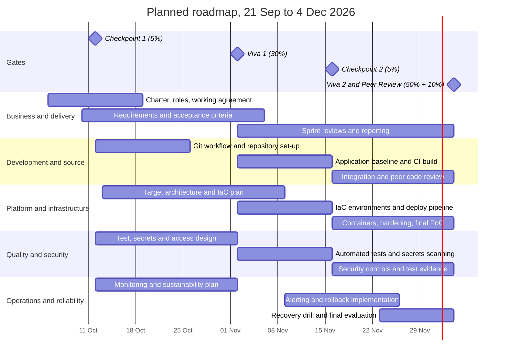

# Roadmap and delivery status

> AI-assisted (Agent 1, Business & Delivery), 26 November 2026. Role area: Galen Kudwoli.
> No team member has reviewed it yet. A function name shows responsibility, not authorship.

## Planned roadmap (as presented on the Viva 1 slide)

Bar dates were read from the slide's bar positions, so treat them as accurate to a day or two. This
chart shows the **plan**, not what happened.

## Planned against actual (snapshot: 26 November 2026, after testing)

On GitHub: pull requests #1 and #4 merged (neither reviewed), Dependabot pull requests #2 and #3 open,
CI, security, release, deploy and monitoring workflows run, `main` unprotected. The AWS stack in
`eu-north-1` runs staging and production. Raw evidence is held by the team outside the repository.

Status words: **Done** (meets the Definition of Done), **Implemented** (built and run, unreviewed),
**Drafted** (files exist, unreviewed), **Not evidenced** (nothing in the project proves it).
Nothing is Done.

| Work item | Planned end | Repository evidence | Status | Against plan |
|---|---|---|---|---|
| Charter, roles, working agreement | 19 Oct | Role names on slides only; no charter file | Not evidenced | Late |
| Requirements and acceptance criteria | 6 Nov | Viva 1 slide; `docs/business/requirements.md` | Drafted | Review outstanding |
| Sprint reviews and reporting | 4 Dec | `sprint-report.yml`, no run recorded; no review notes | Not evidenced | Behind |
| Git workflow and repository set-up | 26 Oct | Repository created 19 Nov; pull requests used; no branch protection | Implemented in part | Late |
| Application baseline and CI build | 16 Nov | Application, tests, CI and release runs | Implemented | Late |
| Integration and peer code review | 4 Dec | PRs #1 and #4 integrated without review | Implemented in part | Peer review at risk |
| Target architecture and IaC plan | 9 Nov | Viva 1 slides; CloudFormation | Implemented | Review outstanding |
| IaC environments and deploy pipeline | 16 Nov | Stack, Ansible, seven pipeline deployments | Implemented | Late |
| Containers, hardening, final PoC | 4 Dec | Image, Compose, SSH hardening on the host | Implemented | Review outstanding |
| Test, secrets and access design | 2 Nov | Viva 1 slides; `docs/quality/` | Drafted | Review outstanding |
| Automated tests and secrets scanning | 16 Nov | Test and security workflows run | Implemented | Late |
| Security controls and test evidence | 4 Dec | Scans, one blocked-then-fixed finding, SSH refusals | Implemented in part | Review outstanding |
| Monitoring and sustainability plan | 2 Nov | Viva 1 slides; monitoring files | Implemented | Review outstanding |
| Alerting and rollback implementation | 26 Nov | Alerts and manual rollback run on the host | Implemented | On the planned date; unreviewed |
| Recovery drill and final evaluation | 4 Dec | Rollback and detection drills; `evaluation.md` | Implemented in part | Third detection run, automatic rollback and restore outstanding |

The repository cannot show whether Checkpoint 1, Viva 1 or Checkpoint 2 took place, or what feedback
was given. The team should record that feedback and the resulting changes.

## Recovery plan to the final viva (proposed)

This chart was proposed before deployment. Integration, deployment and most timed tests happened on
26 November, earlier than shown; human review and branch protection have not happened. It is a plan,
not a record.

28 and 29 November fall on a weekend; the team needs to confirm who is available.

## Dependencies

| # | Dependency | Blocks | Owner | State at 26 Nov |
|---|---|---|---|---|
| D1 | User approval to commit, push and open a pull request | CI, review, everything after | Orchestrator, team | Given |
| D2 | A human reviewer for each change | Definition of Done, REQ-02 | All members | Not met |
| D3 | Merge to `main` | Image release, OIDC deploy, scheduled workflows | Development | Done (PRs #1, #4) |
| D4 | GHCR package set to public (or a read token on the host) | Host image pull | Development, Platform | Host pulls succeed |
| D5 | AWS account, plan type checked, cost approval | Stack, drills | Orchestrator, Business | Done (free plan) |
| D6 | SNS email subscription confirmed | REQ-06 | Operations | Done |
| D7 | Instance running, current public IP, authorised CIDR | Ansible, demo | Platform | Check before each use |
| D8 | Successful production and previous release | Rollback drill | Platform, Operations | Done |

## Responsible functions

| Function | Role area | Next deliverable |
|---|---|---|
| Business and delivery | Galen Kudwoli | Backlog as GitHub issues, review record |
| Development and source | AbdulQuadri Sanusi | Reviewed pull request; Dependabot pull requests |
| Platform and infrastructure | Jesutofunmi Jinadu | Stop/start rehearsal; automatic rollback test |
| Quality and security | Timilehin A. Ibrahim | Branch protection request; failing-test pull request |
| Operations and reliability | Nana Owusu | Third detection run; database-down drill; restore test |

## Next working increment

One change goes through pull request, **human review**, CI, image build and approved deployment to
staging, with the health check reporting the expected commit. Everything except the human review and
an enforced approval has been done once. If time runs short, protect the Musts
(REQ-01 to REQ-04) and state what was left untested.
