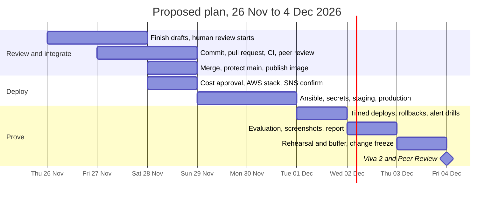

# Roadmap and delivery status

> AI-assisted (Agent 1, Business & Delivery), 26 November 2026. Role area: Galen Kudwoli.
> No team member has reviewed it yet. A function name shows responsibility, not authorship.

## Planned roadmap (as presented on the Viva 1 slide)

Bar dates were read from the slide's bar positions, so treat them as accurate to a day or two. This
chart shows the **plan**, not what happened.

## Planned against actual (snapshot: 26 November 2026, about 03:40 UTC)

Evidence: `evidence/business/repo-state.txt` and the working copy. On GitHub there were two commits
(both 19 November), no pull requests, issues or workflow runs, no environments, and `main` was
unprotected. Files drafted since then are uncommitted and still changing.

Status words: **Done** (meets the Definition of Done), **Drafted** (files exist, unreviewed),
**Not evidenced** (nothing in the project folder proves it), **Not started**. Nothing is Done.

| Work item | Planned end | Repository evidence | Status | Against plan |
|---|---|---|---|---|
| Charter, roles, working agreement | 19 Oct | Role names on slides only; no charter file | Not evidenced | Late |
| Requirements and acceptance criteria | 6 Nov | Viva 1 slide; `docs/business/requirements.md` | Drafted | Late |
| Sprint reviews and reporting | 4 Dec | `sprint-report.yml`, never run; no issues or review notes | Not evidenced | Behind |
| Git workflow and repository set-up | 26 Oct | Repository created 19 Nov; local feature branch | Drafted | Late; no PR or branch protection |
| Application baseline and CI build | 16 Nov | Application and workflow files; workflows never ran | Drafted | Late |
| Integration and peer code review | 4 Dec | No pull requests | Not started | At risk |
| Target architecture and IaC plan | 9 Nov | Viva 1 slides; CloudFormation draft | Drafted | Review outstanding |
| IaC environments and deploy pipeline | 16 Nov | CloudFormation, Ansible, deploy drafts; no AWS stack | Drafted | Late; nothing deployed |
| Containers, hardening, final PoC | 4 Dec | Dockerfile and Compose drafts | Drafted | At risk |
| Test, secrets and access design | 2 Nov | Viva 1 slides | Drafted | Review outstanding |
| Automated tests and secrets scanning | 16 Nov | Test and security workflow drafts; local secret scan in `evidence/quality/` | Drafted | Late; never run in CI |
| Security controls and test evidence | 4 Dec | Part of the above | Drafted | At risk |
| Monitoring and sustainability plan | 2 Nov | Viva 1 slides; monitoring drafts | Drafted | Review outstanding |
| Alerting and rollback implementation | 26 Nov | Alert rules and scripts drafted; never run on a host | Drafted | Late |
| Recovery drill and final evaluation | 4 Dec | Drill script only; no results | Not started | Blocked by deployment |

The repository cannot show whether Checkpoint 1, Viva 1 or Checkpoint 2 took place, or what feedback
was given. The team should record that feedback and the resulting changes.

## Recovery plan to the final viva (proposed)

28 and 29 November fall on a weekend; the team needs to confirm who is available.

## Dependencies

| # | Dependency | Blocks | Owner |
|---|---|---|---|
| D1 | User approval to commit, push and open a pull request | CI, review, everything after | Orchestrator, team |
| D2 | A human reviewer for each change | Definition of Done, REQ-02 | All members |
| D3 | Merge to `main` | Image release, OIDC deploy, scheduled workflows | Development |
| D4 | GHCR package set to public (or a read token on the host) | Host image pull | Development, Platform |
| D5 | AWS account, plan type checked, cost approval | Stack, drills | Orchestrator, Business |
| D6 | SNS email subscription confirmed | REQ-06 | Operations |
| D7 | Instance running, current public IP, authorised CIDR | Ansible, demo | Platform |
| D8 | Successful production and previous release | Rollback drill | Platform, Operations |

## Responsible functions

| Function | Role area | Next deliverable |
|---|---|---|
| Business and delivery | Galen Kudwoli | Backlog as GitHub issues, review record, budget approval |
| Development and source | AbdulQuadri Sanusi | Green CI run and release image |
| Platform and infrastructure | Jesutofunmi Jinadu | Stack, configuration, first deployment |
| Quality and security | Timilehin A. Ibrahim | Scan results, blocked-change and denied-access tests |
| Operations and reliability | Nana Owusu | Alert and rollback drill timings |

## Next working increment

One change goes through pull request, human review, CI, image build and approved deployment to
staging, with the health check reporting the expected commit. If time runs short, protect the Musts
(REQ-01 to REQ-04) and state what was left untested.
