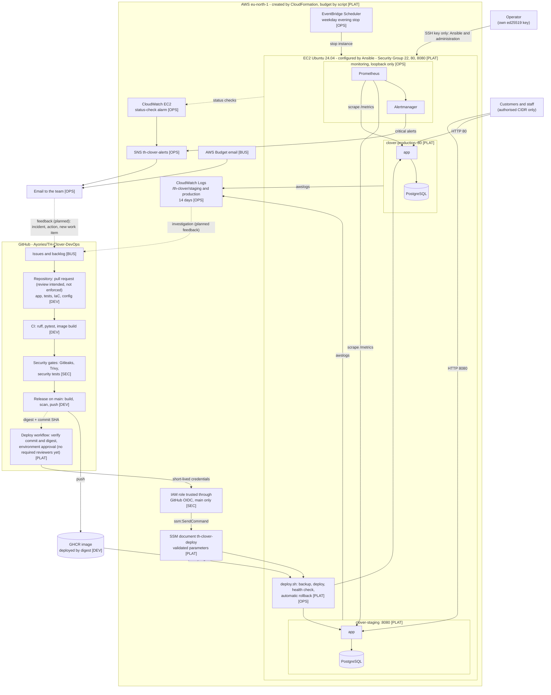

# TH-CLOVER architecture (AI-assisted)

Role area: Platform and Infrastructure (Jesutofunmi Jinadu). The names below mark who owns each area,
not who wrote the files. This describes the version-controlled design. It was deployed to AWS
`eu-north-1` on 26 November 2026. Pull request review and an enforced production approval are intended
and are **not yet in place**.

## End-to-end view

Tags in each box show the owning team function:
**[BUS]** Business and Delivery (Galen Kudwoli), **[DEV]** Development and Source (AbdulQuadri Sanusi),
**[PLAT]** Platform and Infrastructure (Jesutofunmi Jinadu), **[SEC]** Quality and Security
(Timilehin A. Ibrahim), **[OPS]** Operations and Reliability (Nana Owusu).

## What creates what

| Layer | Tool and file | Creates |
|---|---|---|
| AWS resources | CloudFormation, `infrastructure/cloudformation/th-clover.yml` | Security group, EC2, `cloveradmin` (cloud-init), IAM roles, log groups, SNS, alarm, schedule, SSM document, OIDC trust. The budget is created by `infrastructure/budget.sh` |
| Linux configuration | Ansible, `infrastructure/ansible/site.yml` | Packages, SSH hardening, automatic security updates, swap, directories, per-environment secrets, scripts, monitoring |
| Application runtime | Compose, `infrastructure/docker-compose*.yml` | `app` and `db` per environment; same definition for development, staging, production |
| Release to an environment | `.github/workflows/deploy.yml` + `scripts/deploy.sh` | A new `release.env`, containers on the new digest, a JSON line in `deployments.log` |

## Significant design decisions

| Decision | Reason | Trade-off or residual risk |
|---|---|---|
| One EC2 host for staging, production and monitoring | Proportionate cost for a proof of concept | No high availability; staging load can affect production; monitoring dies with the host (partly covered by the CloudWatch status-check alarm) |
| CI/CD uses OIDC + SSM, never SSH | No stored AWS keys or SSH keys in GitHub; port 22 closed to GitHub | `deploy.sh` runs as root through SSM, so the document's parameter validation and the script's own validation matter |
| OIDC subject limited to `main` with repository IDs | The repository was created after 15 July 2026, so GitHub issues the immutable subject format | The parameter must be updated if the repository is renamed or recreated |
| Approval in a separate workflow job | A job with `environment:` changes the OIDC subject; approval is kept, trust stays `ref:refs/heads/main` | The approval only exists with required reviewers on the GitHub environment. None are set, so production approval is only the manual dispatch |
| Deploy by image digest | The tested image is exactly what runs | The operator copies the digest from the release run |
| Secrets generated on the host | Never in Git, CI or the Ansible controller | Plain files readable by root; no central rotation (AWS Secrets Manager would be the next step) |
| Database backup before each deploy | Recovery point if a release damages data | Stored on the same disk; image rollback does not reverse database schema changes |
| No Elastic IP | No charge for an idle address | Public IP changes after every stop/start |
| HTTP only | No domain name in the proof of concept | Staff password and customer data are not encrypted in transit; only an authorised CIDR can connect. TLS is required before real use |
| Single weekday stop, manual start | Reduces running hours | The brief asks to reduce non-production use: stopping the shared host also stops "production" |

Alternatives considered: Terraform (needs state management), Jenkins (a server to run and patch),
SSH from GitHub Actions (stored private key and an open port), ECS or another managed platform (would
remove the infrastructure the brief asks the team to configure and explain).
